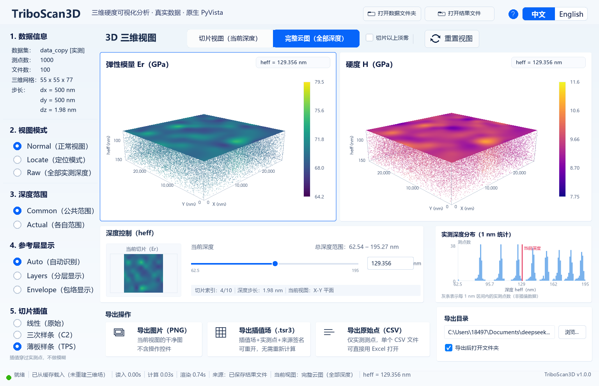

# TriboScan H&Er 3D

A native Windows desktop viewer for 3D hardness measurements. It reads Bruker
`*_analysis.txt` exports, reconstructs Er / H fields, shows two 3D panels with
slices and the full point cloud, and exports PNG, `.tsr3` fields and raw-point
CSV.

This is an independent open-source project. It is not affiliated with, endorsed
by, or supported by any employer or instrument vendor. The sample data in the
release is public demonstration data.



## Features

- Two linked 3D panels (elastic modulus Er and hardness H) with rotate / pan /
  zoom, Normal / Locate / Raw views and common / actual depth ranges.
- Slice view plus full point cloud, reference layers (Auto / Layers / Envelope)
  and haze for distant points.
- Slice interpolation: Linear, Cubic and TPS (default; isotropic and exact at
  measured nodes; display only).
- Export a clean PNG of the two 3D views, a reopenable `.tsr3` field, or the
  original measured points as CSV.
- Empty startup workspace: open a raw folder or an exported `.tsr3` / `.csv`
  directly; cancelling a picker keeps the workspace open.
- UI v2: light design, help overlay (F1), 1280x720 floor, 125 % / 150 % DPI
  scaling, Chinese / English.
- Portable Windows build; no Python or installer required on the target PC.

## Download

Use the latest **Release** for the ready-to-run portable package:

- `TriboScan3D_Portable_Windows_x64_UIv2.zip` — unzip the whole folder and run
  `TriboScan3D.exe` (keep the folder together).
- `sample_data_3d_hardness.zip` — optional sample measurement folder for a
  first run. Unzip it next to the program or anywhere you like, then use
  **Open data folder**.

The package is unsigned; Windows SmartScreen or antivirus may warn. Verify the
SHA-256 published with the release before running.

## Run from source

Requirements: Windows 10/11 x64, Python 3.12, a GPU driver with OpenGL 3.2+.

```bat
py -3.12 -m venv .venv
.venv\Scripts\python -m pip install -r requirements.txt
.venv\Scripts\python -m app
```

With a data folder or an exported result:

```bat
.venv\Scripts\python -m app --data "path\to\*_analysis.txt folder"
.venv\Scripts\python -m app --open-result "path\to\result.tsr3"
```

For the tests, put the sample folder at `..\3d hardness plot raw data` relative
to the repository (the test fixtures use that path):

```bat
.venv\Scripts\python -m unittest discover -s tests
.venv\Scripts\python -m unittest discover -s tests\exports
```

See [docs/02_app_architecture_interfaces.md](docs/02_app_architecture_interfaces.md)
and [docs/USAGE.md](docs/USAGE.md) for the full behavior, CLI options and
export formats.

## Build the portable package

```bat
.venv\Scripts\python -m pip install -r requirements-build.txt
.venv\Scripts\python -m PyInstaller --noconfirm --clean ^
  --distpath dist_candidate --workpath build\pyinstaller_work_candidate ^
  build\triboscan.spec
.venv\Scripts\python build\build.py --finalize dist_candidate\TriboScan3D
```

Details and the verification matrix are in
[docs/06_portable_package_v2.md](docs/06_portable_package_v2.md).

## Repository layout

```text
app/            entry point and application state machine
gui/            PyVista/VTK viewer, Pillow chrome, i18n, welcome window
runtime/        field reconstruction, slicing/interpolation, caching
integration/    export adapters and protocols
tests/          unit/integration tests (offscreen)
build/          PyInstaller spec, assets, build helpers
docs/           design/interface/verification documents
tools/ui_v2/    offscreen and real-window probes
```

## Data and privacy

The program reads the selected folder read-only and writes only inside its own
`cache/`, `results/`, `logs/` and `config/` folders. It does not upload data or
write to the source folder. The public sample data is included for
demonstration only.

## License

MIT — see [LICENSE](LICENSE). Copyright (c) 2026 albertc3h8-droid.

Third-party components (VTK, PyVista, Pillow, NumPy, PyInstaller, fonts) keep
their own licenses; see `build/assets/THIRD_PARTY_NOTICES.txt` in the portable
package.

## Contact

- GitHub: https://github.com/albertc3h8-droid/triboscan-h-and-er-3d
- Issues: https://github.com/albertc3h8-droid/triboscan-h-and-er-3d/issues
