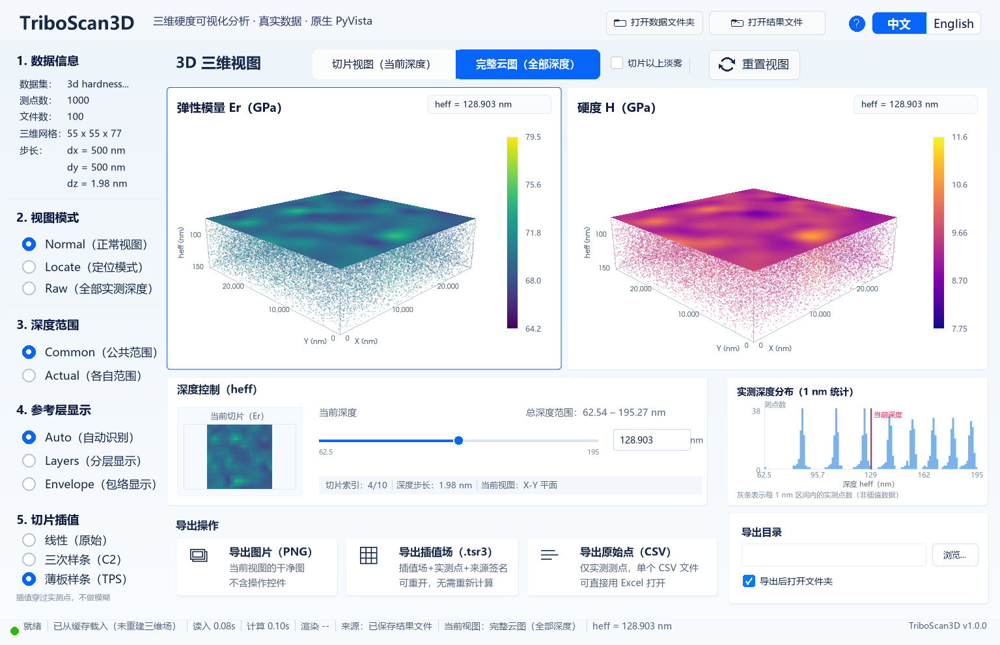

[English](README.md) | **简体中文**

# TriboScan H&Er 3D

用于三维硬度测量的 Windows 原生桌面查看器。读取仪器导出的 `*_analysis.txt`
测量文件夹，重建 Er / H 场，显示两个三维面板（切片与完整点云），并支持导出
PNG、可重开的 `.tsr3` 插值场和原始点 CSV。

这是一个独立的开源项目，不隶属于任何雇主或仪器厂商，也不受其背书或支持。
Release 中的示例数据为公开演示数据。



## 功能

- 两个联动的三维面板（弹性模量 Er、硬度 H），支持旋转 / 平移 / 缩放、
  Normal / Locate / Raw 视图、公共 / 各自深度范围。
- 切片视图与完整点云；参考层（Auto / Layers / Envelope）与远处点的淡雾。
- 切片插值：Linear、Cubic、TPS（默认；各向同性、精确过实测节点；只影响显示）。
- 导出两个三维视图的干净 PNG、可重开的 `.tsr3` 插值场，或原始测量点 CSV。
- 启动空白工作区：可直接打开数据文件夹、已导出的 `.tsr3` 或 `.csv`；
  选择框取消后仍停留在空白界面。
- UI v2：浅色界面、帮助浮层（F1）、1280×720 下限、125% / 150% DPI 缩放、
  中文 / English 切换。
- Windows 便携版；目标电脑不需要安装 Python 或安装程序。

## 下载

请使用最新的 **Release** 中的便携包：

- `TriboScan3D_Portable_Windows_x64_UIv2.zip`：解压整个文件夹后运行
  `TriboScan3D.exe`（不要只拷 exe，保持文件夹完整）。
- `sample_data_3d_hardness.zip`：可选的示例测量数据。解压到任意位置后，
  在程序里选择 **打开数据文件夹**。

程序未签名，Windows SmartScreen 或杀毒软件可能提示；运行前请核对 Release
中公布的 SHA-256。

## 从源码运行

环境：Windows 10/11 x64、Python 3.12、支持 OpenGL 3.2+ 的显卡驱动。

```bat
py -3.12 -m venv .venv
.venv\Scripts\python -m pip install -r requirements.txt
.venv\Scripts\python -m app
```

打开数据文件夹或已导出的结果：

```bat
.venv\Scripts\python -m app --data "path\to\*_analysis.txt folder"
.venv\Scripts\python -m app --open-result "path\to\result.tsr3"
```

运行测试时，请把示例数据文件夹放到仓库旁的
`..\3d hardness plot raw data`（测试夹具使用该路径）：

```bat
.venv\Scripts\python -m unittest discover -s tests
.venv\Scripts\python -m unittest discover -s tests\exports
```

完整行为、命令行参数与导出格式见
[docs/02_app_architecture_interfaces.md](docs/02_app_architecture_interfaces.md)
与 [docs/USAGE.md](docs/USAGE.md)。

## 构建便携包

```bat
.venv\Scripts\python -m pip install -r requirements-build.txt
.venv\Scripts\python -m PyInstaller --noconfirm --clean ^
  --distpath dist_candidate --workpath build\pyinstaller_work_candidate ^
  build\triboscan.spec
.venv\Scripts\python build\build.py --finalize dist_candidate\TriboScan3D
```

构建细节与校验矩阵见
[docs/06_portable_package_v2.md](docs/06_portable_package_v2.md)。

## 仓库结构

```text
app/            入口与应用状态机
gui/            PyVista/VTK 查看器、Pillow 界面、i18n、欢迎层
runtime/        场重建、切片/插值、缓存
integration/    导出适配器与协议
tests/          单元/集成测试（离屏）
build/          PyInstaller spec、资源、构建脚本
docs/           设计/接口/验收文档
tools/ui_v2/    离屏与真窗口探针
```

## 数据与隐私

程序只读打开所选数据文件夹，只在自己的 `cache/`、`results/`、`logs/`、
`config/` 目录内写入；不会上传数据，也不会写回源文件夹。公开的示例数据仅用于
演示。

## 许可

MIT，见 [LICENSE](LICENSE)。Copyright (c) 2026 albertc3h8-droid。

第三方组件（VTK、PyVista、Pillow、NumPy、PyInstaller、字体等）保留各自许可证；
见便携包内的 `build/assets/THIRD_PARTY_NOTICES.txt`。

## 联系

- GitHub：<https://github.com/albertc3h8-droid/triboscan-h-and-er-3d>
- 问题反馈：<https://github.com/albertc3h8-droid/triboscan-h-and-er-3d/issues>
